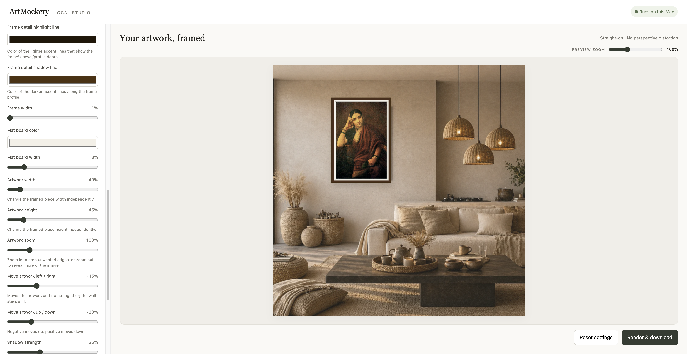
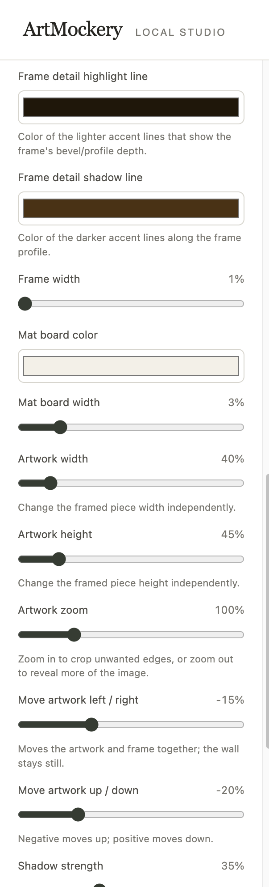

# ArtMockery

ArtMockery is a local web app for previewing artwork on wall backgrounds and exporting high-resolution mockups. The interface is plain HTML, CSS, and JavaScript; a FastAPI backend renders the final image.

## Features

- Preview an uploaded painting in a live mockup.
- Choose from 16 wall finishes, adjust wall tint and texture, or upload a custom wall photo.
- Customize portrait or landscape framing, frame finish and colors, mat board, artwork sizing and zoom, placement, and shadow.
- Zoom and pan around the preview to inspect details.
- Export high-resolution PNG or JPEG mockups, up to 6000 × 6000 pixels.
- Export and import reusable JSON settings for walls and frames; artwork images are not included in config files.
- Run locally in a browser without a separate front-end build step.

## Screenshots

### App overview



### Customization controls



## Requirements

- Python 3.10 or newer
- macOS or Linux for the included `start.sh` script

## Run locally

```sh
git clone <repository-url>
cd art-mockup-app
./start.sh
```

Open <http://127.0.0.1:8000>. The startup script creates `.venv` and installs the packages in `requirements.txt` when it is first run. Stop the server with `Ctrl+C`.

To start the app without the helper script:

```sh
python3 -m venv .venv
source .venv/bin/activate
python -m pip install -r requirements.txt
python -m uvicorn app:app --host 127.0.0.1 --port 8000
```

## Verify the app

Install the development dependencies and run the smoke tests:

```sh
python -m pip install -r requirements-dev.txt
python -m unittest discover -s tests -v
```

GitHub Actions runs these tests on Python 3.10, 3.11, and 3.12.

## Project layout

```text
app.py                 FastAPI routes and application setup
mockup/
  renderer.py          High-resolution export/rendering pipeline
  wall.py              Wall presets, colors, textures, and wall-photo handling
  scenes.py            Room-scene assets and perspective-projection helpers
static/
  index.html           Front-end page structure
  css/style.css        UI styling and responsive layout
  js/app.js            Preview interactions, controls, and export workflow
requirements.txt       Runtime Python dependencies
requirements-dev.txt   Test and development dependencies
start.sh               Local startup script
tests/                 Application smoke tests
```

## Hosting

GitHub can host this source repository, but GitHub Pages cannot run the FastAPI image-rendering backend. To make the app available as a public website, deploy it to a Python-capable application host and configure the server to listen on the host-provided port. The included startup script binds to `127.0.0.1` for local use.

## License and attribution

This project is licensed under the MIT License; see [LICENSE](LICENSE) and [NOTICE](NOTICE). MIT permits closed-source derivatives, but redistributed copies or substantial portions must retain the copyright and permission notice. The NOTICE file requests the attribution “Based on ArtMockery by Samit Shah.” MIT does not require that attribution to be shown in a product UI or for software used only as a hosted service.
